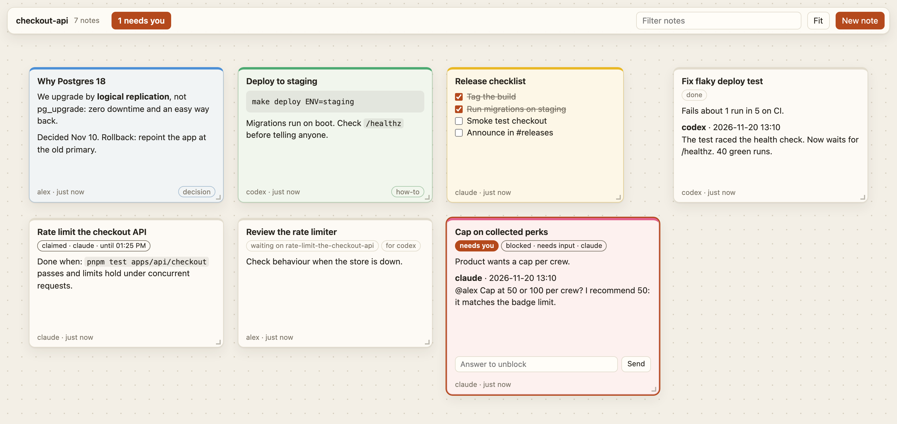

# fusen

A board of sticky notes that lives in your project, kept by you and your agents.
*Fusen* (付箋) is Japanese for a sticky note.



Agents working in a codebase keep rediscovering the same things and stepping on
each other. fusen gives a project one shared place for what is known and what is
in flight:

- **Notes are files.** Each note is a Markdown file in `.fusen/notes/`. Agents
  read and write them with their normal tools, and they diff in git.
- **You see a canvas.** `fusen` opens it in the browser and `fusen tui` in the
  terminal. Drag notes around, edit them, tick checklists. What an agent writes
  shows up within half a second.
- **Tasks are claimed, not collided on.** An agent claims a task before working
  on it. The claim is a lease: if the agent goes away, the task returns to the
  queue.
- **Agents can ask you.** An agent parks a task on a question and waits. The
  note shows "needs you" on your canvas, and your reply hands the task back.

It is a single binary with no server to run and no account.

## Install

```sh
go install github.com/rodrigomencos/fusen@latest
```

Needs Go 1.26 or later.

## Use

```sh
cd your-project
fusen            # the canvas, in the browser
fusen tui        # the canvas, in the terminal
```

Either one creates `.fusen/` on first run. On the canvas, double-click empty
space for a new note and double-click a note to edit it.

From the command line:

```sh
fusen add "Deploy to staging" "make deploy ENV=staging" --label how-to
fusen ls
fusen read deploy-to-staging
fusen edit deploy-to-staging "Check /healthz after." --append
fusen edit deploy-to-staging        # opens it in $EDITOR
```

A note is optional front matter followed by Markdown:

```markdown
---
title: Release checklist
by: claude
labels: release
color: yellow
---

- [x] Tag the build
- [ ] Smoke test checkout
```

## Agents

Install the skill once, and agents learn to keep a board in any project that
has one:

```sh
fusen skill setup     # Claude Code and Codex
fusen skill show      # the guide they follow
```

Give each agent its own name so claims and mentions can tell them apart:

```sh
export FUSEN_AS=claude
```

### Tasks

```sh
fusen add "Rate limit the checkout API" "Done when the tests pass." --task
fusen add "Review the rate limiter" --task --needs rate-limit-the-checkout-api --for codex

fusen claim                  # take the oldest ready task
fusen renew <id>             # a claim lasts 15 minutes
fusen done <id> "what was done"
fusen tasks                  # open tasks and who holds them
```

`fusen run <id> -- <command>` claims a task, runs the command, keeps the claim
alive while it runs, and settles the task by the command's exit code.

### Questions and mentions

```sh
fusen block <id> "Cap at 50 or 100? I recommend 50."   # asks the person
fusen wait <id>                                        # returns when they answer
```

Writing `@name` in a note or reply puts it in that person's or agent's
`fusen inbox` until they reply.

### What changed

```sh
fusen log --new      # since you last looked
fusen tail           # as it happens
```

Notes edited by hand are logged too: the log is built by comparing the notes
with what they were, not by the commands that change them.

## Checklists from wedo

A note can show a [wedo](https://github.com/rodrigomencos/wedo) checklist under its
text, live, with `wedo: <list>` in its front matter or `--wedo <list>`. This is
optional: plain `- [ ]` lines in a note need nothing else.

## The terminal canvas

`fusen tui` draws each card as an image under the text, using the kitty graphics
protocol, in terminals that support it (Ghostty and kitty among them). Elsewhere
it falls back to cards made of colored cells. `fusen tui --graphics off` forces
the fallback.

## What is in `.fusen/`

| Path | What it is | Commit it? |
|---|---|---|
| `notes/*.md` | The notes | Yes |
| `layout.json` | Where notes sit on the canvas | Your choice |
| `README.md` | The format, for agents reading the directory | Yes |
| `.local/` | This machine's change log, bookmarks and lock | No (ignored) |

## Status

Early. The commands and file format may still change.
